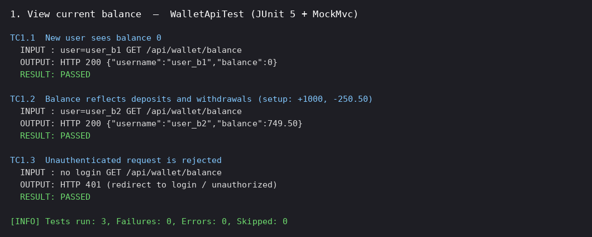
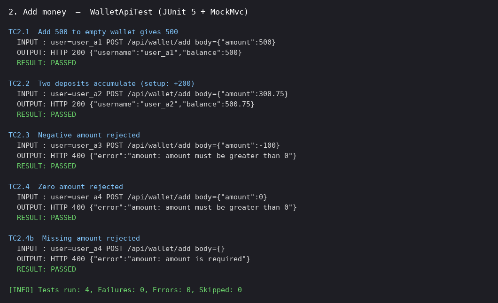
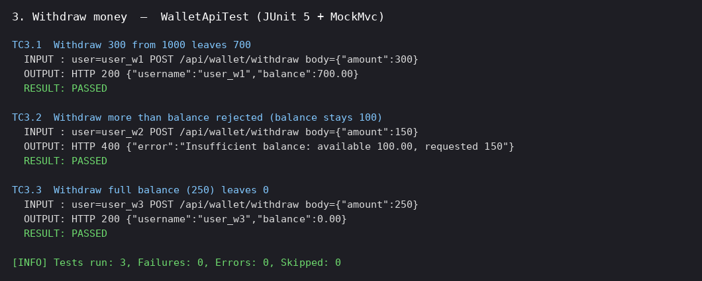
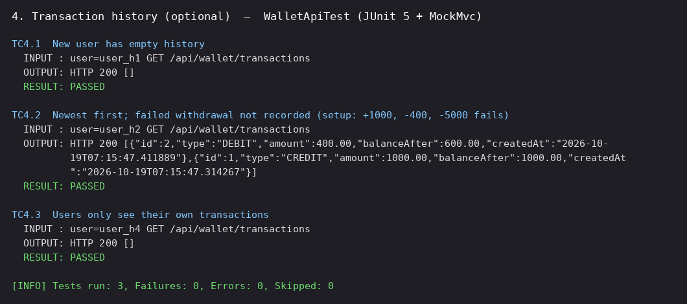

# Wallet: Credit/Debit Wallet (Spring Boot)

A simple credit/debit wallet with login, built for the Vcriate Backend Development assignment.

**Author:** Jayanith Chowdhary · [github.com/jayanith](https://github.com/jayanith)

## Features
| # | Functionality | Endpoint |
|---|---|---|
| 1 | View current balance | `GET /api/wallet/balance` |
| 2 | Add money | `POST /api/wallet/add` `{"amount": 500}` |
| 3 | Withdraw money | `POST /api/wallet/withdraw` `{"amount": 300}` |
| 4 | Transaction history (optional) | `GET /api/wallet/transactions` |

There is also a web UI at `/` (after login) that shows the balance, add and withdraw buttons, and the transaction history.

## Tech stack
- Java 17, Spring Boot 3.2 (Web, Data JPA, Security, Validation)
- H2 in-memory SQL database (console at `/h2-console`, JDBC URL `jdbc:h2:mem:walletdb`)
- JUnit 5 + MockMvc for tests
- HTML/CSS/JavaScript UI served by Spring Boot

## Design patterns
- **Layered architecture:** Controller → Service → Repository, with DTOs (Java records) at the API boundary.
- **Strategy:** `TransactionStrategy` with `CreditStrategy` and `DebitStrategy` decides how each transaction changes the balance. Debit rejects overdrafts.
- **Factory:** `TransactionStrategyFactory` returns the right strategy for a `TransactionType`.
- **Builder:** `WalletTransaction.builder()` creates transaction records.
- **Repository:** Spring Data JPA repositories.
- Optimistic locking (`@Version`) on `Wallet` prevents lost updates, and `@Transactional` service methods keep the balance and history consistent.

## Validation and errors
- Amount must be greater than 0, with at most 2 decimals. Otherwise the API returns `400 {"error": "..."}`.
- Withdrawing more than the balance returns `400 {"error": "Insufficient balance: ..."}`. The balance and history stay unchanged.
- All `/api/**` endpoints require login, and each user sees only their own wallet.

## Run
```bash
mvn spring-boot:run
```
Open http://localhost:8080 and log in with a demo user: **alice / alice123** or **bob / bob123**.

API with curl:
```bash
curl -u alice:alice123 http://localhost:8080/api/wallet/balance
curl -u alice:alice123 -H "Content-Type: application/json" -d '{"amount":500}' http://localhost:8080/api/wallet/add
curl -u alice:alice123 -H "Content-Type: application/json" -d '{"amount":200}' http://localhost:8080/api/wallet/withdraw
curl -u alice:alice123 http://localhost:8080/api/wallet/transactions
```

## Tests
```bash
mvn test
```
`src/test/java/com/jayanith/wallet/WalletApiTest.java` has 13 tests, at least 2 per functionality, and each test prints its input and output. Result: **Tests run: 13, Failures: 0, Errors: 0**.

| Functionality | Test cases |
|---|---|
| View balance | TC1.1 new user → 0 · TC1.2 after +1000 and −250.50 → 749.50 · TC1.3 not logged in → rejected |
| Add money | TC2.1 +500 → 500 · TC2.2 +200 then +300.75 → 500.75 · TC2.3 −100 → 400 error · TC2.4 zero or missing amount → 400 error |
| Withdraw money | TC3.1 1000 − 300 → 700 · TC3.2 100 − 150 → 400 error, balance stays 100 · TC3.3 250 − 250 → 0 |
| History | TC4.1 new user → [] · TC4.2 newest first, failed withdrawal not recorded · TC4.3 users see only their own |

### Test case screenshots (input and output)




